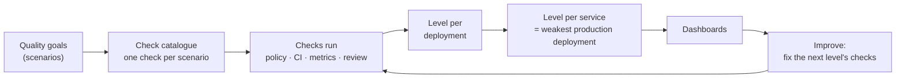
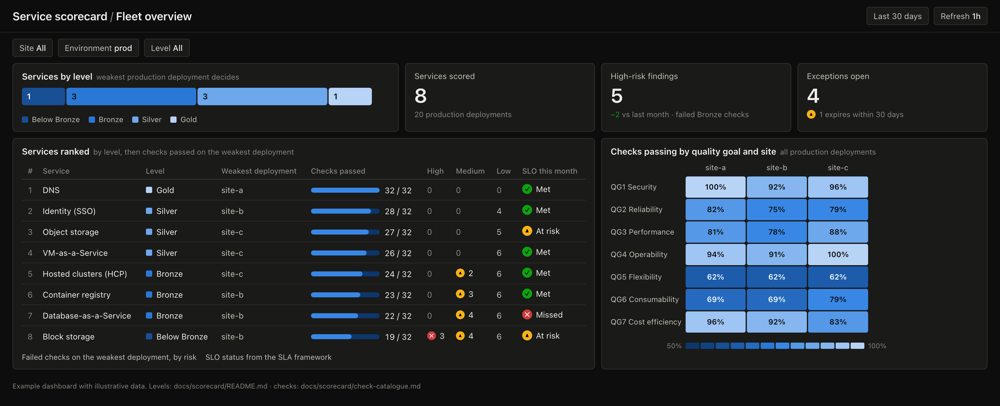
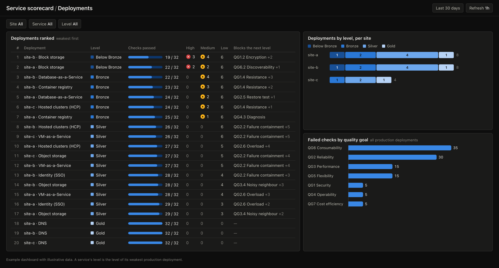
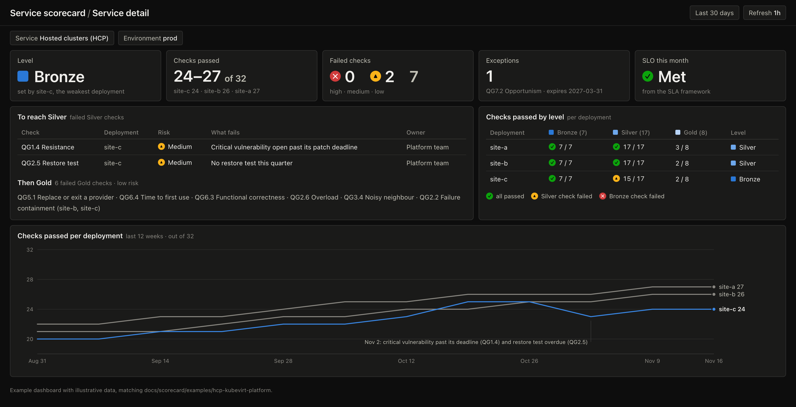

# Service Scorecard

> **Status:** DRAFT v0.1 · **Based on:** fitness functions (Ford, Parsons, Kua; AWS), Well-Architected risk ratings (AWS),
> scorecard levels (Port, Cortex) and the ATAM utility tree (SEI)

The scorecard turns the [quality goals](../quality-goals/README.md) into checks, and ranks every service
and every deployment by the checks it passes. It answers three questions:

- **Where do we stand?** Every service and deployment has a level: Bronze, Silver or Gold.
- **What is most at risk?** Failed checks are ranked High, Medium or Low risk.
- **What next?** The failed checks of the next level are the service's improvement list.

Runtime qualities (reliability, performance) are measured with SLOs in the
[SLA framework](https://github.com/Idan-Maimon/sla-framework). The scorecard checks that those SLOs
exist and are watched, and covers everything else.

## How it works

## Levels

| Level | Meaning | Checks | A failed check is |
|---|---|---|---|
| **Bronze** | Ready for production: the basics every service needs | 7 | **High risk** |
| **Silver** | Operable and secure: runs safely day to day | 17 | **Medium risk** |
| **Gold** | Resilient and portable: survives failures, moves between sites | 8 | **Low risk** |

Which check sits at which level, and where its result comes from: **[check catalogue](check-catalogue.md)**.

## Rules

1. **A level is reached only when every check at that level and below passes.** A deployment that
   passes all Silver checks but misses one Bronze check is *Below Bronze*.
2. **A service's level is the level of its weakest production deployment.** A service is only as good
   as the worst place it runs.
3. **Risk follows the level.** A failed Bronze check is High risk, Silver Medium, Gold Low.
4. **Exceptions and "not applicable" count as passed**, and are always shown on the dashboard.
   An exception is an ADR with an expiry date ([template](templates/exception.md)). When it expires,
   the check fails again. "Not applicable" is declared in the service profile with a reason, e.g.
   backups for a stateless service.
5. **SLO results are shown next to the level, not inside it.** The level measures how the service is
   built and run; whether this month's SLOs were met comes from the SLA framework. A bad month does not
   change the level.

## Steps

| Step | What | Who |
|---|---|---|
| **1. Onboard** | Fill in the [service profile](templates/service-profile.md): owner, on-call, requirements offered, deployments, links to the SLO document and architecture docs | Service owner |
| **2. Measure** | Automated checks report on their own. Checks marked *(review)* are answered in a [scorecard review](review-guide.md) | Platform tooling · review team |
| **3. Rank** | Levels per deployment and per service are calculated and shown on the dashboards | Platform tooling |
| **4. Improve** | The failed checks of the next level become the service's improvement list. Each one is fixed, or accepted as an exception with an expiry date | Service owner, approved by the section leader |

Reviews happen before a new service goes to production, after a major change, and once a year.

## Dashboards

*Example images with illustrative data. Sources: [`diagrams/scorecard-dashboards/`](../../diagrams/scorecard-dashboards/).*

**Fleet overview:** every service, its level, its weakest deployment and its SLO status, plus checks passing by quality goal and site.

**Deployments:** every deployment ranked from weakest to strongest, and the checks that fail most often.

**Service detail:** one service: its level, what blocks the next level, and each deployment's progress.

## Where things live

| What | Where |
|---|---|
| Levels, rules and the check catalogue | Here |
| Each service's profile, review results and exceptions | The service's own repository, next to its SLO document and architecture docs |
| Policies, pipeline templates and alert rules that implement the checks | Platform repositories |
| The job that calculates levels | Platform tooling |
| Levels and rankings | Grafana dashboards. Never committed to git |

## Files

| File | For |
|---|---|
| [check-catalogue.md](check-catalogue.md) | Every check: what passes, scope, signal, level |
| [review-guide.md](review-guide.md) | The half-day scorecard review, for checks a tool can't measure |
| [templates/service-profile.md](templates/service-profile.md) | One per service: owners, deployments, links, exceptions |
| [templates/exception.md](templates/exception.md) | An accepted failed check, with an expiry date |
| [examples/hcp-kubevirt-platform/](examples/hcp-kubevirt-platform/) | A filled-in example (illustrative) |

## Sources

- [Thoughtworks — Fitness function-driven development](https://www.thoughtworks.com/insights/articles/fitness-function-driven-development)
- [AWS — Using Cloud Fitness Functions to Drive Evolutionary Architecture](https://aws.amazon.com/blogs/architecture/using-cloud-fitness-functions-to-drive-evolutionary-architecture/)
- [AWS Well-Architected — custom lens format (risk rules)](https://docs.aws.amazon.com/wellarchitected/latest/userguide/lenses-format-specification.html)
- [Port — production readiness scorecard](https://docs.port.io/guides/all/setup-production-readiness-scorecard/)
- [Cortex — scorecards](https://docs.cortex.io/scorecards)
- [SEI — ATAM: Method for Architecture Evaluation](https://www.sei.cmu.edu/documents/629/2000_005_001_13706.pdf)
